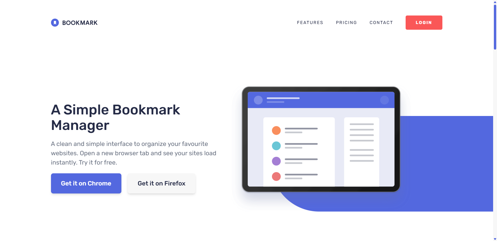

# Bookmark Landing Page

## Overview & Project Scope

Welcome to the **Bookmark Landing Page** web application, a modern, highly interactive, and fully responsive landing page featuring dynamic tabbed components, interactive mobile menus, and modal/popover dialog controls.

## Hero Preview



## Links

- **Live Demo URL:** https://Ahmed-let-front.github.io/bookmark-landing-page/
- **Frontend Mentor Solution:** https://www.frontendmentor.io/challenges/bookmark-landing-page-5d0b588a9edda32581d29158

## AI Collaboration

- 🤖 **UI & Layout Assistance:** AI collaboration was utilized exclusively to assist with structuring and refining the user interface (UI) and layout architecture. All core application logic, DOM manipulation, and programming were independently engineered and implemented by the author.

---

## Logic Architecture Notice

> 💡 **Note:** Since this is a modern front-end **Landing Page**, a complex architectural flowchart is not required. The project relies on clean component rendering, event delegation, and state-driven DOM updates.

---

## Core Features & Logic Pipelines

- 📑 **Dynamic Tabbed Features:** Interactive feature switching with smooth content templating and indicator positioning.
- 📱 **Responsive Mobile Navigation:** Full-screen menu handling with automatic close triggers on link or button selections.
- ⚡ **Interactive Modals & Popovers:** Robust dialog element integration with modern browser API methods.

## Tech Stack & Implementation Details

- 🧱 **Semantic HTML5 Markup:** Clean, accessible, and structured DOM hierarchy leveraging modern dialog elements.
- 💻 **Vanilla JavaScript:** Structured asynchronous JavaScript utilizing ES6 modules and event delegation.
- 🎨 **Tailwind CSS v4:** Utility-first styling utilizing modern CSS features and responsive design variables.
- ⚡ **Vite:** Next-generation frontend tooling ensuring fast HMR and optimized production bundling.

## What I Learned & Architectural Highlights

- Learned how to properly implement and control `<dialog>` elements alongside the `popover` API, understanding their distinct JavaScript methods for opening and closing (`showModal()` / `close()` vs. `showPopover()` / `hidePopover()`).
- Discovered the power of the CSS property `interpolate-size: allow-keywords` which smoothly enables animations from `0` to `auto` and vice versa.
- Learned how to style custom details content using the specialized `::details-content` pseudo-element.

---

## Project Initialization & Local Setup

To run this project locally, follow these steps:

### 1. Clone the repository:

```bash
git clone https://github.com/Ahmed-let-front/bookmark-landing-page.git
```

### 2. Navigate to the project directory:

```bash
cd bookmark-landing-page
```

### 3. Install dependencies:

```bash
npm install
```

### 4. Start the development server:

```bash
npm run dev
```

### 5. Build for production:

```bash
npm run build
```

---

## Vite Build Configuration

The project uses an optimized **vite.config.js** file tailored for production asset bundling and vendor chunk splitting:

```javascript
import { defineConfig } from 'vite';
import tailwindcss from '@tailwindcss/vite';

export default defineConfig({
  plugins: [tailwindcss()],
  base: '/bookmark-landing-page/',
  build: {
    sourcemap: false,
    rollupOptions: {
      output: {
        assetFileNames: 'assets/[name]-[hash][extname]',
        chunkFileNames: 'assets/[name]-[hash].js',
        entryFileNames: 'assets/[name]-[hash].js',
        manualChunks(id) {
          if (id.includes('node_modules')) {
            return 'vendor';
          }
        },
      },
    },
  },
});
```

---

## Author

- GitHub: [ahmed-let-front](https://github.com/Ahmed-let-front)
- Frontend Mentor: [Ahmed yasser](https://www.frontendmentor.io/profile/Ahmed-let-front)
- LinkedIn: [Ahmed Yasser](https://www.linkedin.com/in/ahmed-yasser-frontend/)

---

**Thanks** Created By **Ahmed Yasser** ❤️
